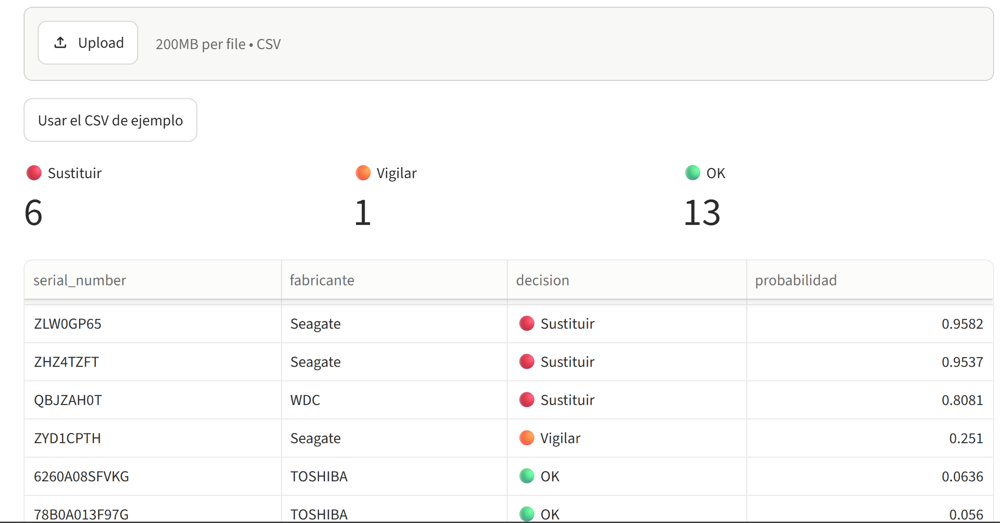
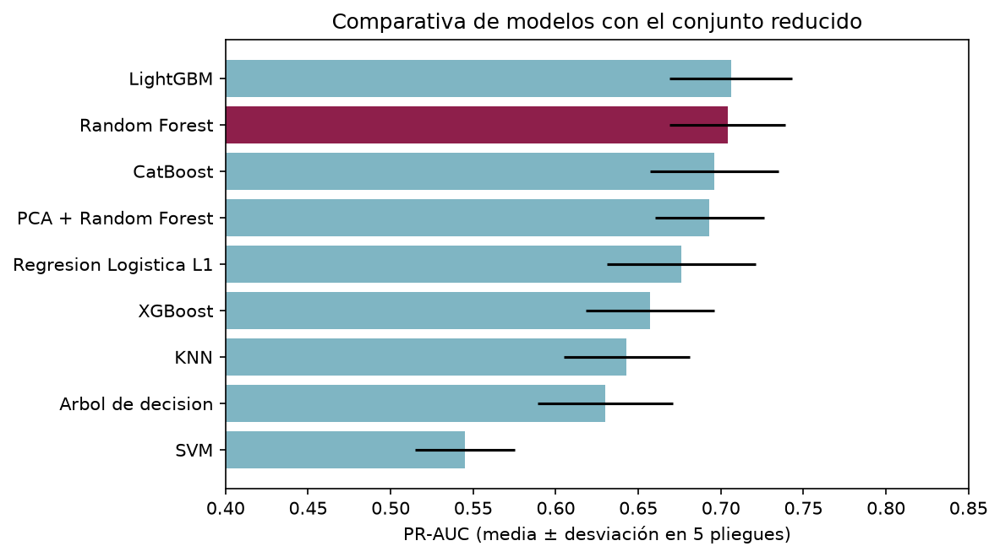
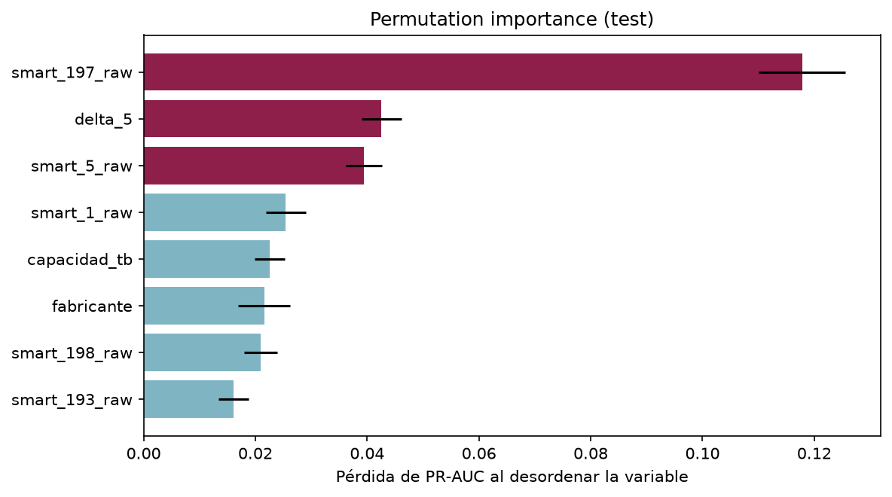

# Uptime Guard · ¿Qué discos van a fallar en los próximos 30 días?

Modelo de Machine Learning que estima, para cada disco duro de un centro de datos, la probabilidad de que falle en los próximos 30 días, y la convierte en un semáforo de acción: **🔴 sustituir · 🟠 vigilar · 🟢 OK**.



## Resultados en una línea

| | Regla de un técnico* | **Uptime Guard** (test) | **Uptime Guard** (abril, mes nunca visto) |
|---|---|---|---|
| Fallos detectados (recall, umbral vigilar) | 66 % | **71 %** (IC 95 %: 67-74 %) | **76 %** |
| Alarmas de sustituir que son fallos reales (precisión) | 57 % | **86 %** (IC 95 %: 82-90 %) | **86 %** |
| PR-AUC | — | **0,725** | 0,763 |

\* Avisar si el disco tiene algún sector dañado (SMART 5, 197 o 198 mayor que 0), medido en train.

Con un coste de 5.000 € por fallo sorpresa, el modelo ahorra unos **1.800 € al mes por cada 1.000 discos**. Compensa a partir de unos 1.300 € por fallo.

## Objetivo

Que el equipo de operaciones sepa qué discos tienen una probabilidad alta de fallar pronto, para cambiarlos antes de que provoquen una avería.

- **Variable objetivo:** `falla_30d` (1 = el disco falla en los próximos 30 días, 0 = no falla).
- **Tipo de problema:** clasificación binaria con clases desbalanceadas (11 % de fallos en la muestra).
- **Métrica:** PR-AUC para comparar modelos; recall para el umbral de vigilar (no dejar escapar fallos) y precisión para el de sustituir (no cambiar discos sanos). La accuracy no sirve: decir siempre «sano» acierta el 89 %.

## Datos

- **Fuente:** [Backblaze Drive Stats](https://www.backblaze.com/cloud-storage/resources/hard-drive-test-data). Estado diario (atributos SMART) de unos 340.000 discos de los centros de datos de Backblaze.
- **Periodo:** 9 fechas de referencia semanales, del 1 de enero al 26 de febrero de 2026. Diciembre de 2025 solo se usa como historial, y la foto del 1 de abril de 2026 es la prueba final.
- **Unión de fuentes:** foto del día + tabla de fallos (target) + lecturas del mismo disco de 7, 14 y 30 días antes, unidas por número de serie y fecha.
- **Tamaño:** 25.993 filas × 123 columnas (2.764 filas que fallan, de 902 discos distintos). Prueba de abril: 4.411 discos.
- **Condiciones de uso:** Backblaze permite usar los datos citándolos como fuente; no se pueden vender los datos en sí.
- **Datos sensibles:** ninguno. Solo hay números de serie y lecturas técnicas de discos, nada personal.

Los zips originales (más de 3 GB) no están en el repositorio. Se descargan de la web de Backblaze y se leen con el notebook `01_Fuentes`.

## Método

1. **Split por disco antes de mirar los datos:** 80 % train / 20 % test, estratificado y con semilla 42. Un mismo disco aparece en varias fechas, así que cada disco va entero a train o a test.
2. **Limpieza decidida solo con train:** fuera los atributos SMART con más del 50 % de missings (solo los mide algún fabricante); medianas y escalado dentro del pipeline.
3. **Feature engineering:** fabricante, capacidad en TB, disco nuevo y 31 tendencias (cuánto ha subido cada contador en 7, 14 y 30 días).
4. **Validación cruzada agrupada por disco:** `StratifiedGroupKFold` con 5 pliegues.
5. **Modelos:** regresión logística L1, KNN, SVM, árbol de decisión, Random Forest, XGBoost, LightGBM, CatBoost y PCA + Random Forest, todos con `Pipeline` + `ColumnTransformer`. No supervisado: PCA y KMeans.
6. **Elección:** Random Forest. Empata con LightGBM (t-test pareado por pliegue, p = 0,31) y supera a la regresión logística (p = 0,04); es más sencillo de ajustar y de explicar.
7. **GridSearchCV multimétrica:** 300 árboles, `max_depth` 12, `min_samples_leaf` 5 y sin pesos de clase. PR-AUC 0,725 en validación cruzada.
8. **Desbalanceo:** probé `class_weight`, SMOTE y undersampling. Los tres bajan la PR-AUC, así que lo trato con el umbral de decisión.
9. **Umbrales con validación cruzada (sin tocar test):** vigilar = 0,20 (detecta al menos el 70 % de los fallos); sustituir = 0,55 (al menos el 85 % de alarmas reales).
10. **Evaluación una sola vez en test**, intervalos bootstrap, permutation importance y prueba final en abril.



## Qué mira el modelo

Lo que más pesa son los **sectores pendientes** (SMART 197), cuánto han subido los **sectores reasignados** en el último mes y su valor actual (SMART 5). La superficie del disco se va dañando antes del fallo.



## Limitaciones

- **Fallos sin aviso:** el 89 % de los fallos que se escapan no tenía ninguna señal en los contadores de sectores. El disco murió de golpe y ningún modelo con estos datos puede verlo; para eso están el RAID y las copias de seguridad.
- **Muestra con más fallos que la realidad:** la muestra tiene un 11 % de fallos para que el modelo aprenda, pero en la flota real fallan unos 0,9 de cada 1.000 discos al mes. En producción habría más falsas alarmas por cada acierto. Por eso el ROI se calcula con la proporción real.
- **Costes supuestos:** 5.000 € por fallo sorpresa, 300 € por cambio planificado y 50 € por falsa alarma. Los umbrales están en `models/config_modelo.json` para ajustarlos a los costes de cada empresa.
- **Periodo corto:** enero-febrero de 2026 para entrenar y abril para la prueba final. El rendimiento cambia por fabricante: mejor en HGST (91 % de recall), peor en Toshiba (62 %).

## Instalación

Python 3.14.7. Desde la raíz del proyecto, en PowerShell:

```
python -m venv venv
venv\Scripts\Activate.ps1
pip install -r requirements.txt
```

## Ejecución

- **Notebooks**, en orden: `01_Fuentes` (necesita los zips de Backblaze) → `02_LimpiezaEDA` → `03_Entrenamiento_Evaluacion`.
- **Scripts**, desde la raíz del proyecto:
  ```
  python src/data_processing.py
  python src/training.py
  python src/evaluation.py
  ```
- **App:**
  ```
  streamlit run app_streamlit/app.py
  ```
  Tiene dos pestañas: subir un CSV con varios discos (o usar el de ejemplo) y revisar un disco con un formulario.

## Estructura

```
uptime-guard/
├── app_streamlit/       app.py, requirements.txt, CSV de ejemplo y valores típicos
├── data/
│   ├── raw/             fuentes extraídas de los zips de Backblaze
│   ├── processed/       dataset unido y limpio, conjuntos de variables
│   ├── train/           train.csv
│   └── test/            test.csv y test_abril.csv
├── docs/
│   ├── img/             figuras y capturas de la app
│   ├── negocio.pptx     presentación de negocio
│   ├── ds.pptx          presentación técnica
│   └── memoria.md
├── models/              final_model.pkl (Random Forest), trained_model_1/2.pkl, config_modelo.json
├── notebooks/           01_Fuentes, 02_LimpiezaEDA, 03_Entrenamiento_Evaluacion
├── src/                 data_processing.py, training.py, evaluation.py
├── requirements.txt
└── README.md
```

## In short (English)

Uptime Guard predicts which hard drives in a data center will fail within the next 30 days, using Backblaze Drive Stats (SMART data, Q1 2026). A Random Forest, validated with disk-grouped cross-validation, catches 71 % of failures at the "watch" threshold on the test set (76 % on an unseen month, April 2026), and 86 % of its "replace" alerts are real failures in both. A Streamlit app turns the probabilities into a traffic light for the operations team.

---

**Sheila Albarrán García** · [GitHub](https://github.com/Sheilalbgar)

Datos: Backblaze Drive Stats.
